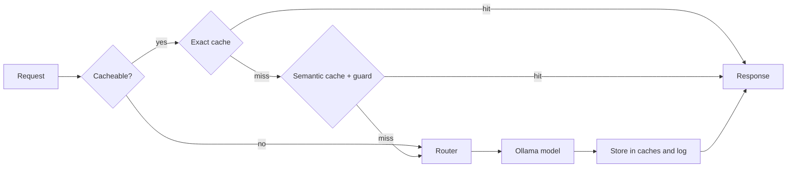

# Semcache

Semcache is an OpenAI-compatible LLM gateway service built with FastAPI that significantly reduces inference costs and response latency by combining an ultra-fast exact Redis cache, a PostgreSQL (`pgvector`) semantic cache protected by rule-based safety guards, and cost-aware N-tier model routing powered by local Ollama models.

**Status:** working prototype. Caching is implemented and tested. Cascade routing, metrics and authentication are planned (see [Roadmap](#roadmap)).

---

## Features

- **OpenAI-compatible `POST /v1/chat/completions`** with extra fields: `cache_status`, `shadow_cost_usd`, `latency_ms`, `routing_rationale`
- **Exact cache (Redis)**: identical requests return in milliseconds
- **Semantic cache (`pgvector` + `all-minilm` embeddings)**: matches paraphrases, protected by negation, number and antonym guards
- **Tier routing** across Ollama models defined in `config/tiers.yaml` (rule-based)
- **Honest metrics**: measured hit latency, tokens and shadow cost saved per request, plus `GET /v1/stats`
- **Evaluation script** that sweeps similarity thresholds over labeled question pairs

---

## How a request flows



---

## Quick start (Windows PowerShell)

**Requirements:** Python 3.11+, Docker Desktop, [Ollama](https://ollama.com/).

```powershell
ollama pull llama3.2:3b
ollama pull llama3.1:8b
ollama pull all-minilm

git clone https://github.com/Akhiil-626/SemCache.git
cd semcache

py -m venv .venv
.\.venv\Scripts\Activate.ps1
pip install -r requirements.txt

Copy-Item .env.example .env
docker compose up -d db redis
alembic upgrade head
uvicorn app.main:app --reload --port 8000
```

Check it: `curl.exe http://127.0.0.1:8000/health`. Interactive API docs are at `http://127.0.0.1:8000/docs`.

**Notes:**

- **macOS/Linux**: use `source .venv/bin/activate` and `cp .env.example .env`.
- `uvicorn --reload` does not re-read `.env`. Restart it after editing `.env`.
- Database credentials in `.env` must match the ones the Postgres container was first created with.
- All settings are documented in `.env.example`. Models and prices live in `config/tiers.yaml`.

<!-- ## Screenshots Add images to docs/images/, then uncomment:  -->

---

## Usage

```powershell
$body = @{
    model = "small"
    messages = @(@{ role = "user"; content = "Name three uses of a hash table." })
} | ConvertTo-Json -Depth 5

Invoke-RestMethod -Uri http://127.0.0.1:8000/v1/chat/completions `
    -Method Post `
    -ContentType "application/json" `
    -Body $body
```

`model` is a tier name from `config/tiers.yaml` (for example `small` or `large`). Sending the same request again returns (response excerpt):

```json
{
  "model": "ollama_chat/llama3.2:3b",
  "usage": {
    "prompt_tokens": 33,
    "completion_tokens": 198,
    "total_tokens": 231
  },
  "tier": "small",
  "cached": true,
  "cost_usd": 0.0,
  "shadow_cost_usd": 0.0,
  "latency_ms": 2.07,
  "routing_rationale": "Retrieved from exact key-value cache.",
  "cache_status": "exact_hit"
}
```

On a hit, `usage` shows the original answer's token counts and the consumed cost is 0.

`cache_status` is one of `miss`, `exact_hit`, `semantic_hit`, `bypass` or `skipped`. Send the header `Cache-Control: no-cache` to bypass both caches.

### Endpoints

| Endpoint                    | Purpose                                                      |
| :-------------------------- | :----------------------------------------------------------- |
| `POST /v1/chat/completions` | OpenAI-compatible chat completion                            |
| `POST /api/v1/query`        | Legacy query endpoint                                        |
| `GET /v1/stats`             | Hit rates, latency percentiles, tokens and shadow cost saved |
| `GET /health`               | Liveness (no dependencies checked)                           |
| `GET /health/ready`         | Readiness (database, Redis, Ollama)                          |

---

## How the caching works

- **Exact cache.** The key is a SHA-256 hash of tenant, tier, model, cache version, messages, temperature and max tokens. Messages are trimmed and whitespace-collapsed but not lowercased, because casing can change the meaning of code and identifiers. Bumping `CACHE_VERSION` invalidates everything.
- **Semantic cache.** The question is embedded with `all-minilm` (384 dimensions). pgvector finds the nearest stored question, where $\text{similarity} = 1 - \text{cosine distance}$. A hit needs $\text{similarity} \ge \text{SIMILARITY\_THRESHOLD}$ (default `0.88`) and must pass the guard.
- **Why a guard.** Embeddings place opposites close together. _"Is it safe to take this medication?"_ vs _"Is it dangerous to take this medication?"_ scores higher than any true paraphrase in the evaluation set, so no threshold can separate them. The guard rejects a hit when the two questions differ in negation words, numbers or antonym pairs (`config/antonyms.yaml`). Only informational questions use the semantic cache. Commands such as _"Delete my account"_ can only be served by the exact cache.
- **Shadow cost.** Local models cost $0, so every request is also priced at configurable reference prices per 1M tokens (`config/tiers.yaml`). This makes savings measurable.
- **Honest metrics.** Hit latency is measured, not estimated. `tokens_saved`, `saved_latency_ms` and `saved_shadow_cost_usd` come from the original call.

---

## Results

_Single runs on one local machine, not benchmarks._

| Test                 | Original LLM call | From cache                                                      |
| :------------------- | :---------------- | :-------------------------------------------------------------- |
| **Identical repeat** | 23,326 ms         | 2.07 ms (`exact_hit`)                                           |
| **Paraphrase**       | 20,561 ms         | 992 ms (`semantic_hit`, includes an embedding-model cold start) |

**Threshold 0.88 on 45 labeled pairs with all-minilm:** 7 of 10 paraphrases hit. Without the guard, 9 of 35 non-paraphrase pairs would also hit (25.7%). With the guard, 0 of 35.

**Limitations.** The guard is rule-based and its rules were written alongside the test pairs, so a hold-out evaluation is still pending. Semantic hits pay for an embedding call, and so does every miss. Local models are slow on CPU.

---

## Evaluation and tests

```powershell
python eval\similarity_report.py  # per-pair similarity and threshold sweep
pytest -q                         # test suite
```

`eval/pairs.json` contains `paraphrase`, `unrelated`, `near_opposite` and `adversarial` pairs. The sweep reports the paraphrase hit rate and false-hit rate with and without the guard.

---

## Project structure

```
semcache/
├── app/                  # API routes, cache, routing, embeddings, LLM client, DB models
├── alembic/              # Database migrations
├── config/               # tiers.yaml (models, shadow prices), antonyms.yaml
├── eval/                 # Labeled pairs and similarity report
├── scripts/              # PowerShell test helpers
├── tests/                # Pytest suite
├── docker-compose.yml    # Postgres (pgvector) and Redis
└── .env.example
```

---

## Troubleshooting

- **Ollama connection refused or model missing**: start Ollama and run the `ollama pull` commands above.
- **Postgres "password authentication failed"**: credentials only apply when the container is first created. To reset local data (this deletes it): `docker compose down -v`, then `docker compose up -d db redis` and `alembic upgrade head`.
- **Port 5432 or 6379 already in use**: change the mapped port in `docker-compose.yml` and update `.env`.
- **First request is slow**: Ollama is loading the model into memory.

---

## Security

- There is no authentication yet. Run it on localhost and do not expose it publicly.
- Never commit `.env`. The development credentials in `.env.example` are for local use only.
- Prompts and responses are stored in the `requests` and `semantic_cache` tables. Treat the database as sensitive.

---

## Roadmap

- [ ] Hold-out evaluation of the semantic guard
- [ ] Cascade routing with quality validators
- [ ] Prometheus metrics and Grafana dashboards
- [ ] API keys, tenant quotas and rate limiting
- [ ] PII handling before caching
- [ ] Load testing and CI

---

## License

Not yet chosen.
